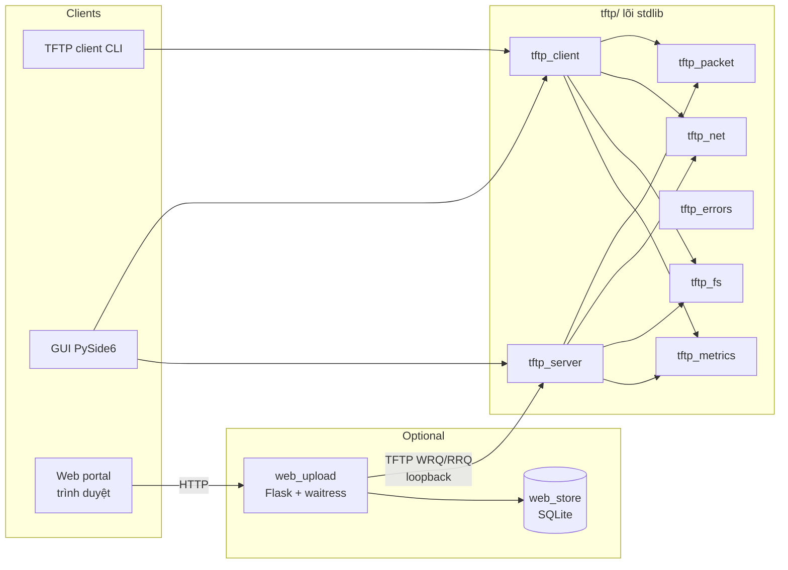
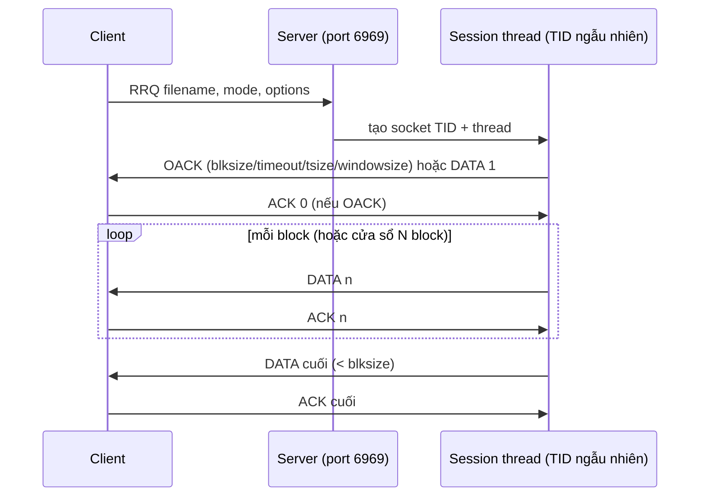
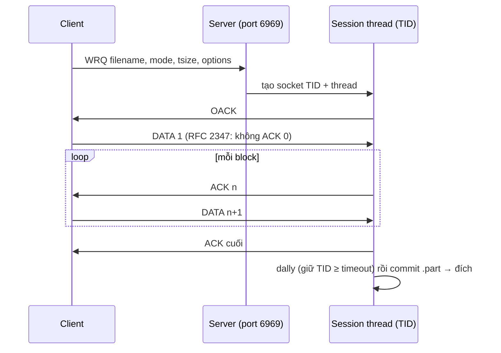

# Kiến trúc hệ thống

Tài liệu này giải thích **các tầng, luồng dữ liệu và quyết định thiết kế** của
dự án. Nó bổ sung cho `docs/RFC-1350-notes.md` (chi tiết giao thức) và
`docs/deployment.md` (vận hành).

## 1. Mục tiêu và ràng buộc

| Mục tiêu | Cách thể hiện |
|---|---|
| Đúng RFC 1350/2347/2348/2349/7440 | parser chặt, test fuzz + interop |
| Lõi chỉ dùng stdlib | `tftp/*.py` không import Flask/PySide6 |
| Chạy trong LAN tin cậy | ACL, giới hạn upload/quota/session, không hứa bảo mật |
| Không mất dữ liệu | ghi `.part` + commit atomic, khoá theo tên |
| Quan sát được | metrics counter/gauge/timer + log có rotation |
| Windows là công dân hạng nhất | `SO_EXCLUSIVEADDRUSE`, reparse point, UTF-8 console |

## 2. Sơ đồ tầng

## 3. Luồng một phiên

### RRQ (tải về)

### WRQ (gửi lên)

## 4. Mô hình thread và TID

- Một thread dispatcher đọc mọi listener (`select`), tạo **một thread cho mỗi
  phiên**; `--max-clients` chặn số phiên.
- Mỗi phiên có socket UDP riêng (TID), bind cùng family với listener và trong
  `--tid-port-range` nếu cấu hình.
- Khoá phiên là `(ip, port, scope_id)` + so khớp `(filename, mode, options)` để
  không replay nhầm khi OS cấp lại ephemeral port.
- Sau ACK cuối của WRQ, socket TID được giao cho **dally pool** (một thread
  chung) để ACK lại DATA cuối bị thất lạc mà không chiếm slot `max-clients`.
- Shutdown: listener đóng → gửi ERROR cho phiên → join thread → đóng dally pool.

## 5. An toàn dữ liệu phía ghi

1. Mở `.<name>.<random>.part` bằng `mkstemp` **trong thư mục đích** (cùng
   filesystem để rename/link atomic).
2. Ghi + `fsync` file.
3. Commit:
   - `--overwrite`: `os.replace`.
   - mặc định: `tftp_fs.commit_without_overwrite` — hard link → fallback
     `O_EXCL` + copy (FAT32/exFAT không hỗ trợ hard link).
4. Lỗi/timeout: `.part` bị xoá trong `finally`; file cũ không bị đụng.
5. Quota/đĩa: kiểm tra trước và định kỳ trong lúc nhận; cache dung lượng root
   + reservation cho upload đang chạy.

## 6. Ranh giới bảo mật

| Thành phần | Có gì | Không có gì |
|---|---|---|
| TFTP | ACL theo subnet, chặn path traversal/symlink, giới hạn tài nguyên | xác thực, mã hoá, phân quyền người dùng |
| Portal web | tài khoản scrypt, session opaque + CSRF + Origin, cookie `__Host-` khi HTTPS, CSP, rate limit, audit log | TLS tự ký (dùng reverse proxy), chống malware, quyền theo file tuỳ ý |
| Mạng | firewall chỉ mở port + dải TID cho subnet | NAT traversal tự động |

Nguyên tắc: **không thêm "bảo mật" không tương thích vào TFTP**. Nếu cần danh
tính/mã hoá, dùng HTTPS/SFTP ở tầng ngoài.

## 7. Quyết định thiết kế (ADR ngắn)

| # | Quyết định | Vì sao |
|---|---|---|
| 1 | Tự viết parser thay vì `struct` rải rác | fuzz được, một nguồn chân lý cho opcode/option |
| 2 | Thread-per-session thay vì asyncio | TFTP là I/O blocking đơn giản; 32 phiên LAN không cần event loop, dễ debug |
| 3 | Không bật `SO_REUSEADDR` | trên Windows cho phép hai server cùng bind UDP và chia gói im lặng |
| 4 | Dùng hai listener cho dual-stack | `IPV6_V6ONLY` khác nhau giữa OS; hai socket cho hành vi nhất quán |
| 5 | `--windowsize` mặc định 1 | không phá client cũ; bật khi cả hai đầu hỗ trợ |
| 6 | Receiver ACK từng block, sender giữ cửa sổ | ACK nào cũng là ACK luỹ tiến; tránh phải buffer gói đến muộn, vẫn đạt lợi ích RTT |
| 7 | Web gateway nói TFTP qua loopback | tận dụng lại toàn bộ chính sách/quota/atomic của server |
| 8 | Metrics tự viết thay vì Prometheus client | lõi stdlib; `render_prometheus()` đủ cho scrape |
| 9 | Ghi `.part` cùng thư mục đích | rename/link atomic, không lộ file dở qua TFTP |

## 8. Điểm mở rộng

- **Option mới**: thêm vào `OPTION_NAMES` + negotiate + test (xem
  `CONTRIBUTING.md §4`).
- **Storage backend**: thay `tftp_fs` bằng S3/HTTP nếu cần — giữ nguyên giao
  thức packet/session.
- **Metrics exporter**: dùng `render_prometheus()` trong HTTP server riêng cho
  lõi TFTP (portal đã có `/metrics`).
- **GUI**: thêm trang mới trong `tftp/gui/main_window.py`; worker đặt ở
  `tftp/gui/workers.py` (nếu tách).
